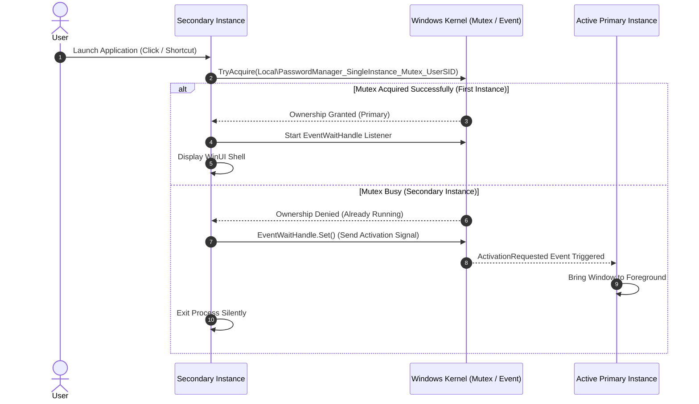

# Storage Architecture, Directory Security (ACL), and Single-Instance Management

* **Version:** 1.0 (M0.6)
* **Date:** October 7, 2026
* **Target Platform:** Windows 11 x64

---

## 1. Storage Paths: Packaged (MSIX) vs. Unpackaged

To maintain flexibility during development and local toolchain workflows, `PasswordManager` initially operates as **Unpackaged (`WindowsPackageType=None`)**, evaluating **MSIX** packaging at Milestone M9. Therefore, storage paths are abstracted via the `IStoragePathProvider` port to handle environment differences transparently.

| Environment | Data Root Path | SQLite Vault File | Backups Directory |
| :--- | :--- | :--- | :--- |
| **Unpackaged (Desktop)** | `%LOCALAPPDATA%\PasswordManager` | `%LOCALAPPDATA%\PasswordManager\vault.db` | `%LOCALAPPDATA%\PasswordManager\backups\` |
| **Packaged (MSIX Container)** | `%LOCALAPPDATA%\Packages\<PackageFamilyName>\LocalState` | `...\LocalState\vault.db` | `...\LocalState\backups\` |

### Environment Detection
At application startup, the Win32 `GetCurrentPackageFullName` API is invoked. If the API returns `APPMODEL_ERROR_NO_PACKAGE` (15700), the process is confirmed to be unpackaged Win32, and the `%LOCALAPPDATA%\PasswordManager` path is used.

---

## 2. SQLite File Structure and WAL Behavior

The storage engine employs SQLite **Write-Ahead Logging (WAL)** mode for high performance and concurrency.

1. **`vault.db`**: Primary database file (encrypted envelopes and manifest).
2. **`vault.db-wal`**: Write-Ahead Log journal (uncommitted transactions or uncheckpointed frames).
3. **`vault.db-shm`**: Shared memory index file.

> [!CAUTION]
> **Backup Security:** When backing up or migrating a vault, copying only the `vault.db` file while a WAL file exists will result in losing recent uncheckpointed writes. The backup logic in Milestone M3 will utilize the SQLite Online Backup API or an atomic checkpoint snapshot mechanism.

---

## 3. Windows NTFS Directory Security (ACL Policy)

To prevent other local user accounts on the same machine from accessing the encrypted vault files, a strict Windows NTFS Access Control List (ACL) is enforced when creating the root storage directory:

1. **Inheritance Protection:**
   Inheritance from parent directories (`C:\Users\<User>`) is disabled via `SetAccessRuleProtection(isProtected: true, preserveInheritance: false)`.
2. **Restricted Access Control Matrix:**
   - **Current User (`WindowsIdentity.GetCurrent().User`):** `FullControl`.
   - **Local Administrators (`BuiltinAdministratorsSid`):** `FullControl`.
   - **Local System (`LocalSystemSid`):** `FullControl`.
   - **Other Users (`Users`, `Authenticated Users`, `Everyone`):** **No Access.**

---

## 4. Single-Instance Lifecycle Management

Launching multiple concurrent instances of the application under the same user session can cause database lock contention and memory inconsistency.

### Design Principles:
1. **Session Isolation:** Mutex and event handles reside in the `Local\` namespace and incorporate the user's SID (`Local\PasswordManager_SingleInstance_Mutex_Default_{UserSID}`). In Windows Fast User Switching environments, distinct users can run their own application instances independently.
2. **User Experience:** When the user launches the application while it is already running, a duplicate instance does not open; instead, the active window is brought to the foreground.
