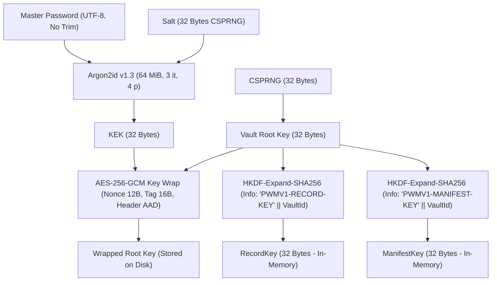

# Vault Format & Cryptographic Specification — VAULT_FORMAT (v1.0)

* **Version:** 1.0 (Milestone M1.1)
* **Date:** 2026-10-10
* **Status:** Approved / Active
* **Target Platform:** Windows 11 (x64), .NET 10
* **Related Standards & Documents:** `THREAT_MODEL.md`, `ADR-002`, `ADR-003`, `SECURITY_TEST_MATRIX.md`

---

## 1. Overview & Core Principles

The `PasswordManager` vault is stored locally on Windows 11 as a SQLite database file (`vault.db`), adhering strictly to local-first and zero-knowledge principles.

### Core Architectural Principles:
1. **Plaintext Isolation:** No account information, usernames, passwords, URLs, titles, or search indexes exist as plaintext in the database. SQLite exclusively stores encrypted binary envelopes.
2. **Cryptographic Version Decoupling:** The cryptographic format version (`CryptoFormatVersion = 1`) is managed independently from the database schema version (`SchemaVersion = 1`). Database schema adjustments do not break the underlying crypto format.
3. **Master Password Integrity:** The user's master password is never written to disk or logged; it is never silently trimmed or normalized. UTF-8 byte sequences are passed directly to the KDF.
4. **Two-Tier Key Hierarchy:** The KEK (Key Encryption Key) derived from the master password is used solely to wrap the Vault Root Key. Records and manifests are encrypted not with the KEK, but with independent sub-keys derived from the Root Key via HKDF.
5. **Fail-Closed Security Guarantee:** Any mismatch in authentication tag, AAD context, or parameter boundaries results in an immediate fail-closed state; zero partial data is decrypted or delivered to the UI.

---

## 2. Vault Header (VaultHeader) Binary Format

The vault header is a fixed 132-byte binary structure stored as a single row in the `VaultHeader` table.

### 2.1. Binary Layout

| Offset | Field Name | Size | Data Type / Encoding | Description |
| --- | --- | --- | --- | --- |
| 1 | `Magic` | 4 bytes | ASCII `"PWMV"` (`0x50, 0x57, 0x4D, 0x56`) | File format identifier (PasswordManager Vault). |
| 2 | `CryptoFormatVersion` | 4 bytes | `uint32` (Big-Endian) | Crypto format version. Value is `1` for v1. |
| 3 | `VaultId` | 16 bytes | Binary GUID (RFC 4122) | Unique vault identifier. Prevents cross-vault record injection. |
| 4 | `KdfAlgorithmId` | 2 bytes | `uint16` (Big-Endian) | `0x0001` = Argon2id v1.3. |
| 5 | `MemoryKiB` | 4 bytes | `uint32` (Big-Endian) | Argon2id memory cost in KiB. Default: `65536` (64 MiB). |
| 6 | `Iterations` | 4 bytes | `uint32` (Big-Endian) | Argon2id iteration count. Default: `3`. |
| 7 | `Parallelism` | 4 bytes | `uint32` (Big-Endian) | Argon2id parallelism lanes. Default: `4`. |
| 8 | `SaltLength` | 2 bytes | `uint16` (Big-Endian) | Salt length in bytes. Default: `32`. |
| 9 | `Salt` | 32 bytes | Cryptographic Random (CSPRNG) | 256-bit random salt used for KEK derivation. |
| 10 | `WrappedKeyNonce` | 12 bytes | Cryptographic Random (CSPRNG) | 96-bit AES-GCM nonce wrapping the root key. |
| 11 | `WrappedKeyTag` | 16 bytes | AES-GCM Auth Tag | 128-bit authentication tag for the wrapped root key. |
| 12 | `WrappedKeyCiphertext` | 32 bytes | AES-256-GCM Ciphertext | 256-bit Vault Root Key encrypted with the KEK. |

*Total Header Size:* 132 bytes.

---

## 3. Key Lifecycle & Derivation Hierarchy



### 3.1. Master Password & KEK Derivation (Argon2id)
* **Input:** Raw characters entered by the user converted directly to UTF-8 bytes (`byte[]`). No silent trimming of leading/trailing whitespace; no Unicode normalization.
* **Algorithm:** Argon2id (v1.3, RFC 9106 compliant).
* **Default Parameters:**
  - Memory: `64 MiB` ($65,536 \text{ KiB}$)
  - Iterations ($t$): `3`
  - Parallelism ($p$): `4` lanes
  - Salt: `32 bytes` (CSPRNG)
  - Output: `32 bytes` (256-bit KEK)
* **Anti-DoS & Parameter Bounding Policy:**
  Parameters read from file headers or imports must pass strict validation before Argon2id execution:
  - Memory: $\min 16 \text{ MiB} \le \text{MemoryKiB} \le 512 \text{ MiB}$
  - Iterations: $1 \le \text{Iterations} \le 10$
  - Parallelism: $1 \le \text{Parallelism} \le 16$
  - Salt Length: $16 \le \text{SaltLength} \le 64$ bytes
  Values outside these bounds trigger immediate fail-closed rejection.

### 3.2. Vault Root Key & Wrapping (AES-256-GCM)
* When creating a vault, a 32-byte cryptographic random (CSPRNG) Root Key (`RootKey`) is generated.
* The Root Key is encrypted using the KEK via **AES-256-GCM**.
* **Key Wrap AAD (Additional Authenticated Data):**
  The first 72 bytes of the header are bound canonically:
  $$\text{AAD}_{\text{wrap}} = \text{Magic (4B)} \mathbin{\Vert} \text{CryptoFormatVersion (4B)} \mathbin{\Vert} \text{VaultId (16B)} \mathbin{\Vert} \text{KdfId (2B)} \mathbin{\Vert} \text{MemoryKiB (4B)} \mathbin{\Vert} \text{Iterations (4B)} \mathbin{\Vert} \text{Parallelism (4B)} \mathbin{\Vert} \text{SaltLength (2B)} \mathbin{\Vert} \text{Salt (32B)}$$
  If an adversary modifies KDF parameters or Salt in the file, auth tag verification fails and the root key is never decrypted.

### 3.3. Cryptographic Key Separation (HKDF-SHA-256)
The Root Key never encrypts records directly. Purpose-specific sub-keys are derived using `HKDF-Expand` (RFC 5869):
* **RecordKey:**
  $$\text{RecordKey} = \text{HKDF-Expand}(\text{RootKey}, \text{info} = \text{UTF8}("\text{PWMV1-RECORD-KEY}") \mathbin{\Vert} \text{VaultId (16B)}, L = 32)$$
* **ManifestKey:**
  $$\text{ManifestKey} = \text{HKDF-Expand}(\text{RootKey}, \text{info} = \text{UTF8}("\text{PWMV1-MANIFEST-KEY}") \mathbin{\Vert} \text{VaultId (16B)}, L = 32)$$

---

## 4. Encrypted Envelopes

Every encrypted item (records and manifest) is stored as an independent AES-256-GCM envelope.

### 4.1. Record Envelope (VaultRecord Envelope)

A fresh 96-bit CSPRNG nonce is generated for every encryption.

* **Canonical Record AAD:**
  $$\text{AAD}_{\text{record}} = \text{VaultId (16B)} \mathbin{\Vert} \text{RecordId (16B)} \mathbin{\Vert} \text{EnvelopeVersion (4B, Big-Endian)} \mathbin{\Vert} \text{UTF8}("\text{PWMV1-RECORD}")$$
  *Security Impact:* If a record is copied into another vault (`VaultId` mismatch) or substituted under a different record ID in the same vault (`RecordId` mismatch), AEAD tag verification fails immediately.

* **Plaintext Record Payload (Canonical JSON):**
  ```json
  {
    "schema_version": 1,
    "title": "GitHub",
    "username": "developer@example.com",
    "password": "SyntheticSecretPassword123!",
    "urls": ["https://github.com/login"],
    "notes": "Work account",
    "category": "Development",
    "is_favorite": true,
    "created_at": "2026-10-10T14:30:00.0000000Z",
    "updated_at": "2026-10-10T14:30:00.0000000Z",
    "revision": 1
  }
  ```

* **Field Size Constraints:**
  - `title`: Maximum 256 characters.
  - `username`: Maximum 256 characters.
  - `password`: Maximum 4096 characters (accommodates long tokens/passphrases).
  - `urls`: Maximum 10 array items, each maximum 2048 characters (strictly `http://` and `https://` schemes).
  - `notes`: Maximum 10,000 characters.
  - `category`: Maximum 64 characters.

### 4.2. Manifest Envelope (VaultManifest Envelope)

Stores active record IDs, revision counters, and vault configurations.

* **Canonical Manifest AAD:**
  $$\text{AAD}_{\text{manifest}} = \text{VaultId (16B)} \mathbin{\Vert} \text{EnvelopeVersion (4B, Big-Endian)} \mathbin{\Vert} \text{UTF8}("\text{PWMV1-MANIFEST}")$$

* **Plaintext Manifest Payload (Canonical JSON):**
  ```json
  {
    "schema_version": 1,
    "vault_name": "Personal Vault",
    "categories": ["General", "Work", "Finance", "Social"],
    "records": [
      {
        "record_id": "a0000000-0000-0000-0000-000000000001",
        "revision": 1
      }
    ],
    "last_modified_at": "2026-10-10T14:30:00.0000000Z"
  }
  ```
  *Integrity Role:* If a record is deleted from SQLite or an outdated record is substituted, the discrepancy between the manifest record list and physical records is detected.

---

## 5. SQLite Database Table Schema

The SQLite schema is versioned as `SchemaVersion = 1`.

```sql
-- Vault Header (Single Row: Id = 1)
CREATE TABLE IF NOT EXISTS VaultHeader (
    Id INTEGER PRIMARY KEY CHECK (Id = 1),
    HeaderBytes BLOB NOT NULL,
    CreatedAt TEXT NOT NULL,
    UpdatedAt TEXT NOT NULL
);

-- Vault Manifest (Single Row: Id = 1)
CREATE TABLE IF NOT EXISTS VaultManifest (
    Id INTEGER PRIMARY KEY CHECK (Id = 1),
    EnvelopeVersion INTEGER NOT NULL,
    Nonce BLOB NOT NULL,
    Tag BLOB NOT NULL,
    Ciphertext BLOB NOT NULL,
    UpdatedAt TEXT NOT NULL
);

-- Encrypted Records
CREATE TABLE IF NOT EXISTS VaultRecords (
    RecordId TEXT PRIMARY KEY,
    EnvelopeVersion INTEGER NOT NULL,
    Nonce BLOB NOT NULL,
    Tag BLOB NOT NULL,
    Ciphertext BLOB NOT NULL,
    CreatedAt TEXT NOT NULL,
    UpdatedAt TEXT NOT NULL
);

-- Vault Metadata & Schema Version
CREATE TABLE IF NOT EXISTS VaultMetadata (
    Key TEXT PRIMARY KEY,
    Value TEXT NOT NULL
);
```

---

## 6. Security & Lifecycle Protocols

### 6.1. Master Password Change Protocol (Key Re-Wrap)
Changing the master password does not require re-encrypting records:
1. Current and new master passwords acquired; current password verified and `RootKey` loaded into memory.
2. Fresh 32-byte CSPRNG Salt generated for new master password.
3. New KEK derived (`Argon2id`).
4. Existing `RootKey` re-encrypted using new KEK and fresh CSPRNG Nonce (Re-wrap).
5. New `VaultHeader` binary updated within a single SQLite transaction.
6. Temporary KEK and password buffers wiped with `ZeroMemory`.

### 6.2. Root Key Rotation
Executed upon suspected key compromise or approaching the $2^{32}$ encryption threshold:
1. Fresh 32-byte CSPRNG `RootKey` generated.
2. New `RecordKey` and `ManifestKey` derived.
3. All existing records and manifest decrypted and re-encrypted with new keys and fresh nonces.
4. New `RootKey` wrapped with active KEK.
5. All updates committed atomically in a single transaction.

### 6.3. Fail-Closed & Error Handling Policy
* If the header byte length is not exactly 132 bytes,
* If `Magic` bytes do not match `"PWMV"`,
* If `CryptoFormatVersion` is unsupported,
* If KDF parameters violate bounding limits,
* If AES-GCM authentication tag (`Tag`) verification fails,
* If Record or Manifest AAD mismatch occurs:

**The application terminates the operation immediately (`fail-closed`) and returns a uniform, safe error message:**
`"Failed to open vault: authentication failed or data corrupted."`
